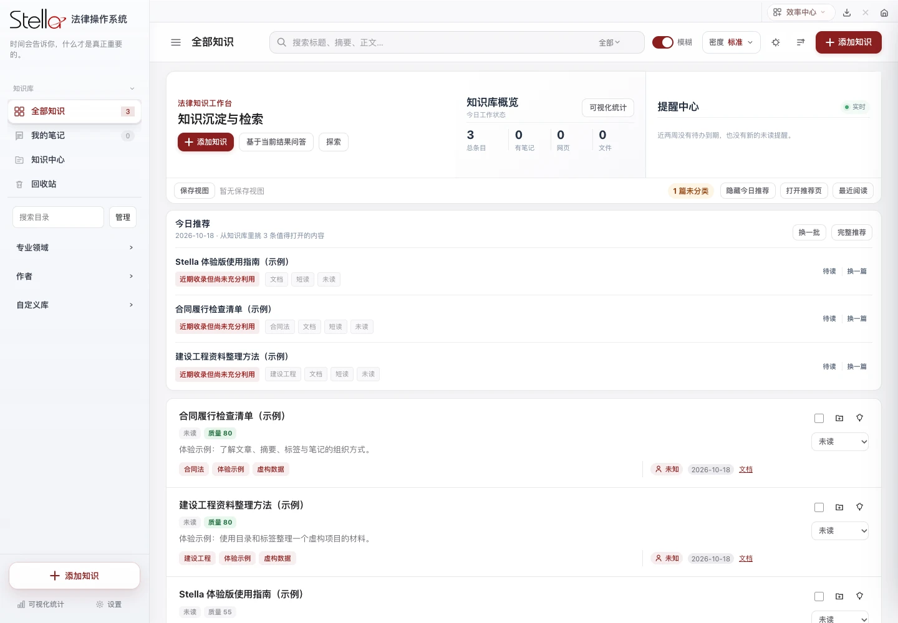

<h1 align="center">让法律工作，有条理地发生。</h1>

知识 · 案件 · 文书 · AI 辅助工具，一个本地工作空间。

<a href="https://liu-zongjin.github.io/stella-downloads/"><b>浏览 Stella 官网式下载页 ↗</b></a>　·　<a href="https://github.com/liu-zongjin/stella-downloads/releases/download/v1.0.0-preview3/Stella-macOS-AppleSilicon-v1.0.0-preview3.zip"><b>直接下载 Mac 应用 ↓</b></a>

### 三步开始

1. 下载 **Stella-macOS-AppleSilicon-v1.0.0-preview3.zip**，支持 Apple 芯片 Mac、macOS 11.3 或更新。
2. 解压，将 **Stella.app** 拖入“应用程序”。无需 Python、Node.js 或 GitHub 账号。
3. 打开体验虚构演示资料。应用尚未经过 Apple 公证；如系统阻止打开，请按“系统设置 → 隐私与安全性”提供的“仍要打开”流程确认来源。

[发布说明及 SHA-256 校验](https://github.com/liu-zongjin/stella-downloads/releases/tag/v1.0.0-preview3) · [反馈与定制联系](https://github.com/liu-zongjin/stella-downloads/issues/new)

### 公开版提供什么

- 知识库、笔记、案件管理、标准文书生成和可自行配置的 AI 工具。
- 用户名可编辑、可隐藏；首页侧边栏问候语默认隐藏，开启后与品牌左对齐。
- 授权委托书、法定代表人证明书、业务审批表保留标准名称；文书可设置自己的律所名称及 Logo，应用品牌独立保存。
- 所函一键上传与自动审批、文书快速报批、会议室预定、打印机扫描盘仅保留入口，页面提示需定制化开发，详情请联系作者。

### 数据与许可

安装包仅含虚构演示资料，不含作者团队身份、联系方式、证件、真实客户或案件资料、密钥与会话。公开版移除私人财务“个人中心”，数据独立保存在 `~/Library/Application Support/StellaPublic`。

AI、邮箱、法院与 MCP 等服务使用你自己的账号；联网操作会向相应服务发送相关数据。Chrome、Office 转换器等外部应用按功能需要自行配置。

**本仓库公开分发应用，应用源码保持私有。** 使用条件见 [LICENSE](LICENSE)：非商业使用、禁止修改、保留作者署名。第三方组件遵守[各自许可](THIRD_PARTY_NOTICES.md)。GitHub 自动提供的“Source code”压缩包仅包含本分发仓库的网页和说明，不含应用源码。
