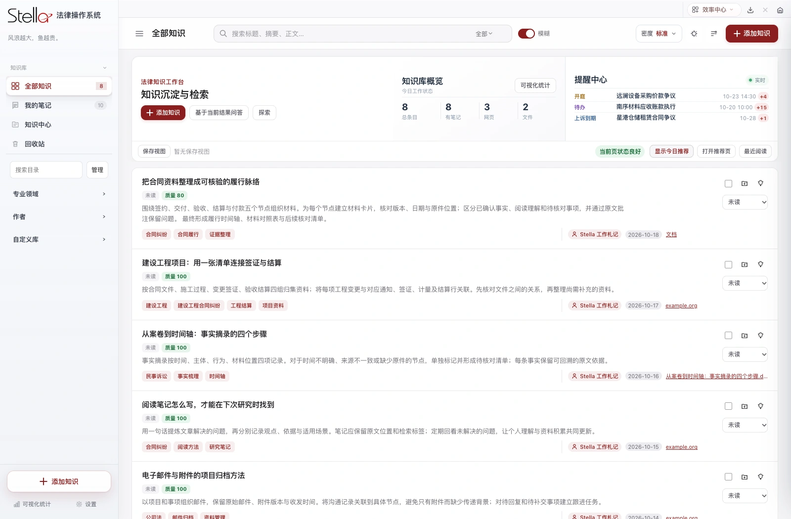

<h1 align="center">让法律工作，有条理地发生。</h1>

知识 · 案件 · 文书 · AI 辅助工具，一个本地工作空间。

<a href="https://liu-zongjin.github.io/stella-downloads/"><b>前往官网，选择适合设备的版本 ↗</b></a>

### 下载 Stella 1.1.5

| 版本 | 系统要求 | 安装文件 |
| --- | --- | --- |
| Apple 芯片 Mac | macOS 12+ | [DMG 安装包](https://github.com/liu-zongjin/stella-downloads/releases/download/v1.1.5-2026102109/Stella-macOS-AppleSilicon-1.1.5.dmg) |
| Intel 芯片 Mac | macOS 12+ | [DMG 安装包](https://github.com/liu-zongjin/stella-downloads/releases/download/v1.1.5-2026102110/Stella-macOS-Intel-1.1.5.dmg) |
| Windows 公开体验版 | Windows 10 1809+ / 11，Intel / AMD 64 位 | [引导安装器](https://github.com/liu-zongjin/stella-downloads/releases/download/windows-v1.1.5-2026102111/Stella-Windows-1.1.5-setup.exe) |

Mac 打开 DMG 后，将 Stella.app 拖入“应用程序”。应用尚未经过 Apple 公证，首次打开时请按官网的安全验证指引确认来源。Windows 运行引导安装器，首次联网准备浏览器、OCR、文档转换及业务组件；暂不支持 ARM、32 位和 Windows Server。

两种 Mac 功能相同，仅架构不同。Windows 以文本、TXT、截图确认导入司法短信；Mac 另有 iCloud 短信、苹果通讯录/日历、生物识别、Finder 标签、录音及夸克/飞书联动。

Mac 1.1.3 / 1.1.4 可收到对应架构的更新提示，适用时使用签名增量包；Windows 仅下载有变化的组件。更早的 Preview 或未配置下载通道的开发版需手动安装一次新版。升级前备份重要资料；旧 Mac 版若在应用包内存过邮箱附件或发票导出，请额外复制一份旧 Stella.app 留存。

已完成实际安装包页面、法答网、文档处理及匿名资料升级检查。Intel 在 Rosetta 验证，Windows 在 CI 验证；尚未完成实体 Intel Mac、Windows 10/11 桌面及真实外部账号业务复测。

最新校验值和验证记录随各版本 Release 提供；根目录的 SHA256.txt / PUBLIC_VERIFICATION.json 对应历史 Preview 4。

[发布说明及 SHA-256 校验](https://github.com/liu-zongjin/stella-downloads/releases) · [反馈与定制联系](https://github.com/liu-zongjin/stella-downloads/issues/new)

### 用 Stella 做什么

- **案件管理**：台账、系列案件、待办、开庭、保全、期限与本地文件围绕案件组织。
- **司法短信联动**：识别 iCloud 同步到 Mac「信息」的司法短信，匹配案件，按条件生成事项并尝试下载送达文书。
- **一张网与自动化立案**：同步法院账户中的待办、消息、电子送达和案件；辅助从材料扫描、信息核对走到官网草稿填报，最终提交由本人确认。
- **知识收集与阅读**：网页、公众号、文档、法规及会议记录多来源收录；智能目录、摘要、笔记批注和全文检索共同整理知识。
- **邮箱与发票**：QQ、腾讯企业、网易企业邮箱集中使用；发票扫描筛选、批量导出与月度自动归集。
- **实务工具**：法答网精选答问、分段利息计算、标准文书生成、案件研究与 AI 辅助。

[浏览完整功能与工作流程 →](https://liu-zongjin.github.io/stella-downloads/) · [更新日志](https://liu-zongjin.github.io/stella-downloads/#updates)

### 数据与许可

安装包使用空白初始化或虚构演示资料，不含作者团队身份、联系方式、证件、真实客户或案件资料、密钥与会话。公开版移除私人财务“个人中心”，Mac 数据独立保存在 `~/Library/Application Support/StellaPublic`；Windows 资料保存在用户目录，与可替换组件分离。

AI、邮箱、法院与 MCP 等服务使用你自己的账号；联网操作会向相应服务发送相关数据。Windows 引导器会准备浏览器、OCR 与文档转换组件；Mac 的外部应用按功能指引配置。

**本仓库公开分发应用，应用源码保持私有。** 使用条件见 [LICENSE](LICENSE)：非商业使用、禁止修改、保留作者署名。第三方组件遵守[各自许可](THIRD_PARTY_NOTICES.md)。GitHub 自动提供的“Source code”压缩包仅包含本分发仓库的网页和说明，不含应用源码。
